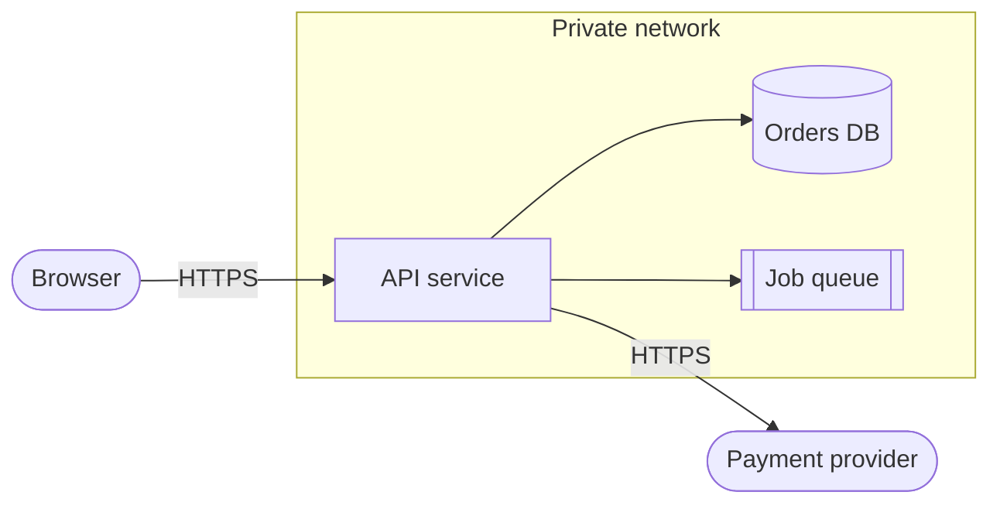

# Threat modeling

Read this for every T3 change, and for any T2 change that adds a trust boundary or touches authentication, authorisation, secrets, personal data, payments, file handling, outbound requests to user-supplied addresses, or an AI agent that can call tools. Record the result in [the threat model worksheet](../templates/threat-model.md).

## Contents

- [Choose the depth](#choose-the-depth)
- [Answer the four questions](#answer-the-four-questions)
- [Model the system](#model-the-system)
- [Find threats with STRIDE](#find-threats-with-stride)
- [Look for abuse of the business logic](#look-for-abuse-of-the-business-logic)
- [Decide a response for each threat](#decide-a-response-for-each-threat)
- [Turn mitigations into tests](#turn-mitigations-into-tests)
- [Worked example: file upload](#worked-example-file-upload)
- [Failure modes](#failure-modes)
- [Sources](#sources)

## Choose the depth

| Situation | Depth |
|---|---|
| T2 change with one security trigger | A ten-minute pass: list the trust boundaries crossed, the top three threats and their mitigations in the PR description. |
| T3 change, new service, new external integration, or an agent with tools | The full worksheet, reviewed with the design before implementation. |
| Change to an existing modelled system | Update the existing model when the change adds a data flow, a data store, an actor or a trust boundary. |

## Answer the four questions

The Threat Modeling Manifesto organises the work around four questions. Answer each one in writing.

1. "What are we working on?" Produce the diagram and asset list described below.
2. "What can go wrong?" List threats per element and per trust boundary.
3. "What are we going to do about it?" Choose a response for each threat.
4. "Did we do a good enough job?" Check that the diagram matches the code, that every high-ranked threat has a tested mitigation, and that accepted risks have an owner.

## Model the system

Apply it:

1. Draw a data flow diagram with external entities (users, partner systems), processes (your services and jobs), data stores, data flows, and trust boundaries.
2. Mark a trust boundary wherever the level of trust changes: internet to application, application to database, your service to a third-party API, a tenant's data to another tenant's, untrusted content into a language model's context, the CI pipeline into production.
3. List the assets an attacker would want: personal data, credentials and tokens, money or credits, availability, integrity of records, and the reputation that depends on them.
4. List the actors, including the unwelcome ones: anonymous visitor, ordinary user, user of another tenant, administrator, malicious insider, compromised dependency, and an automated agent acting on someone's behalf.

## Find threats with STRIDE

Walk every element and every flow that crosses a trust boundary, and ask the STRIDE question for each category.

| Threat | Property it violates | Question to ask | Typical mitigations |
|---|---|---|---|
| Spoofing | Authentication | Can someone act as another user, service or system? | Strong authentication, mutual TLS or signed tokens between services, verified webhook signatures |
| Tampering | Integrity | Can data be changed in transit, at rest, or through an unchecked input? | TLS, server-side validation, integrity checks, least-privilege write access |
| Repudiation | Non-repudiation | Could someone deny an action and could we not prove otherwise? | Audit logs with actor, action, target and time, kept where the actor cannot alter them |
| Information disclosure | Confidentiality | Can data reach someone who should not see it, including through errors, logs or caches? | Object-level authorisation, encryption, redaction, generic error messages |
| Denial of service | Availability | Can someone exhaust CPU, memory, storage, connections, quotas or money? | Rate limits, size limits, timeouts, quotas, budgets and alerts on spend |
| Elevation of privilege | Authorisation | Can someone gain rights they were not granted? | Deny by default, server-side checks on every request, separation of admin paths |

For a feature built on a language model or an agent, add the checks in [ai-features.md](ai-features.md). The most important one is whether a single agent combines private data, exposure to untrusted content and a way to send data out, a combination Simon Willison calls the lethal trifecta.

## Look for abuse of the business logic

STRIDE finds technical threats; attackers also use features exactly as built. Ask:

- Can a step be skipped, repeated or reordered (applying a coupon twice, confirming an order before paying)?
- Can two concurrent requests both succeed where only one should (double spending, overselling stock)?
- Can identifiers be guessed or enumerated to probe for other users' records or accounts?
- Can a client set fields it should not control (role, price, owner identifier) through mass assignment?
- Can a cheap request trigger expensive work (exports, report generation, model calls) at scale?

## Decide a response for each threat

| Response | When to use it |
|---|---|
| Mitigate | Reduce likelihood or impact with a control. This is the usual answer. |
| Eliminate | Remove or redesign the feature that creates the threat. Often the cheapest secure option. |
| Transfer | Move responsibility to another party, for example a payment provider or insurer. The risk to users may remain. |
| Accept | Keep the risk when the alternatives cost more than the harm. Record who accepted it, why, and when it will be reviewed. |

Rank threats with a simple high, medium or low for likelihood and for impact. Precise-looking scores give false confidence. Treat threats that cross a trust boundary to reach a high-value asset as high until shown otherwise.

## Turn mitigations into tests

Apply it:

1. Write each agreed mitigation as a security requirement and an acceptance criterion. Reference an OWASP ASVS requirement where one fits, so reviewers can compare against a public standard.
2. Back each requirement with a test that would fail if the control were removed (for example, "a user of tenant A receives 404 for tenant B's invoice identifier").
3. Track mitigations that are not done yet as issues linked from the worksheet. An untracked mitigation is an accepted risk that nobody accepted.
4. Store the model next to the design in the repository and update it in the same change that alters data flows or trust boundaries.

## Worked example: file upload

| Threat | Category | Mitigation | Test |
|---|---|---|---|
| Uploaded HTML or SVG runs script when viewed | Tampering, elevation | Allowlist file types by content inspection, serve user files from a separate domain with `Content-Disposition: attachment` | Upload an SVG with script; assert it downloads instead of rendering |
| A 5 GB upload fills the disk | Denial of service | Size limit enforced while streaming, per-user quota | Upload over the limit; assert 413 and no stored file |
| Filename `../../app/config` overwrites files | Tampering | Generate storage names server-side; never use the client's filename as a path | Path traversal name is stored under a random key |
| User downloads another user's file by changing the identifier | Information disclosure | Authorisation check on every download, unguessable identifiers as a second layer | Cross-user download returns 404 |
| "Import from URL" fetches internal metadata endpoints | Information disclosure | Outbound allowlist, block private and link-local address ranges after DNS resolution | Request to an internal address is refused |

## Failure modes

- The model is drawn once for a review, filed away, and no longer matches the system six months later.
- The threat list is generic ("hackers", "SQL injection") and not tied to this system's flows and assets.
- Mitigations are agreed in a meeting but never become tests or tracked issues.
- Risks are accepted without a named owner or a review date.
- Output from a language model or an internal service is treated as trusted because it comes from "inside".

## Sources

- The [Threat Modeling Manifesto](https://www.threatmodelingmanifesto.org/) (CC BY 4.0) is the source of the four questions quoted above.
- OWASP, [Threat Modeling Cheat Sheet](https://cheatsheetseries.owasp.org/cheatsheets/Threat_Modeling_Cheat_Sheet.html), describes data flow diagrams, STRIDE and the four response options.
- Microsoft, [Threat Modeling Tool threats](https://learn.microsoft.com/en-us/azure/security/develop/threat-modeling-tool-threats), defines the six STRIDE categories.
- OWASP, [Application Security Verification Standard](https://asvs.owasp.org/), provides the requirement catalogue to reference when writing security requirements.
- Simon Willison, [The lethal trifecta for AI agents](https://simonwillison.net/2025/Jun/16/the-lethal-trifecta/), explains why private data, untrusted content and external communication must not meet in one agent.
