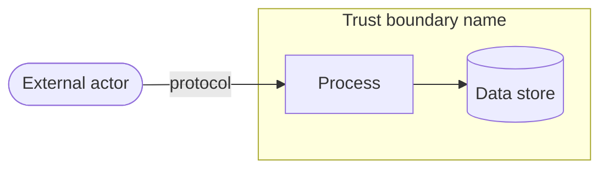

# Threat model: <system or change name>

<!-- Use with references/threat-modeling.md. Keep this file next to the design and update it in the
     same change that alters data flows, data stores, actors or trust boundaries. The four section
     headings are the questions of the Threat Modeling Manifesto
     (https://www.threatmodelingmanifesto.org/, CC BY 4.0). -->

| Field | Value |
|---|---|
| Scope | <what is in and out of scope> |
| Authors and reviewers | <names or roles> |
| Version and date | <v1, YYYY-MM-DD> |
| Related | <design one-pager, decision records, issues> |

## 1. What are we working on?

| Asset | Classification | Where it lives |
|---|---|---|
| <for example customer invoices> | <personal, financial, credentials, public> | <store, cache, logs, third party> |

| Actor | Trust level | Notes |
|---|---|---|
| <anonymous visitor, user, other tenant, administrator, insider, compromised dependency, agent> | | |

## 2. What can go wrong?

| ID | Element or flow | Threat | STRIDE category | Likelihood (H/M/L) | Impact (H/M/L) |
|---|---|---|---|---|---|
| T1 | | | | | |

Business logic abuse considered (skipped steps, replays, races, enumeration, mass assignment, expensive requests):

<notes>

For features using a language model or agent:

| Question | Answer |
|---|---|
| Does it access private data? | |
| Is it exposed to untrusted content (user input, documents, web, email, tool results)? | |
| Can it communicate externally or take actions? | |
| Which of the three is removed or controlled, and how? | |
| Which actions need human approval? | |

## 3. What are we going to do about it?

| Threat ID | Response (mitigate, eliminate, transfer, accept) | Control | Verification (test or check) | Issue |
|---|---|---|---|---|
| T1 | | | | |

Accepted risks:

| Threat ID | Why accepted | Accepted by | Review date |
|---|---|---|---|
| | | | |

## 4. Did we do a good enough job?

- [ ] The diagram matches the code and deployment as built.
- [ ] Every high-ranked threat has a control and a test, or an accepted risk with an owner.
- [ ] Mitigations are tracked as issues until done.
- [ ] Reviewers other than the author have challenged the list.
